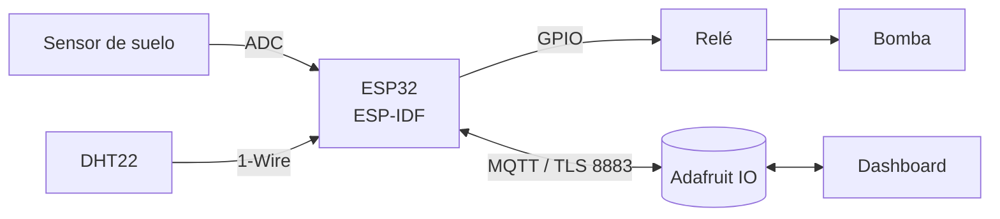

# Regadera automática IoT 🌱

Sistema de riego automático para una planta en maceta. Un **ESP32** programado en **ESP-IDF** (bare-metal sobre FreeRTOS) mide la humedad del suelo y del aire, enciende una mini bomba cuando la tierra está seca y envía todo a **Adafruit IO** por **MQTT sobre TLS**, donde un dashboard muestra los datos y permite regar a distancia o cambiar el umbral.

- **Problema:** las plantas se secan o se pudren por riego irregular (olvidos, viajes, exceso de agua).
- **Solución:** riego por demanda según la humedad real del suelo, con monitoreo y control remoto.

## Características

- Riego automático por umbral de humedad, con pausa de absorción entre riegos.
- Dashboard en Adafruit IO: humedad del suelo, temperatura, humedad del aire, estado de la bomba y alertas.
- Control remoto: botón de **riego manual** y slider para cambiar el **umbral**.
- **Funciona sin internet:** la decisión de riego es local; la nube solo monitorea y controla.
- Seguridad: si se riega 3 veces y la humedad no sube (depósito vacío o sensor fuera de la tierra), el riego se bloquea y se envía una alerta.
- Driver propio para el DHT22, con verificación de checksum y tolerancia a fallos.
- Estado `online`/`offline` con MQTT Last Will.
- Pruebas unitarias de la lógica de riego y CI en GitHub Actions.

## Arquitectura



Detalles, tópicos, flujo de control y manejo de errores en [docs/arquitectura.md](docs/arquitectura.md).

## Hardware (BOM)

| Componente | Cant. | Función |
|---|---|---|
| ESP32 DevKit (30 pines, USB-C) | 1 | Microcontrolador con WiFi |
| Sensor de humedad de suelo YL-69 + módulo FC-28 | 1 | Humedad del suelo (analógico) |
| DHT22 / AM2302 | 1 | Temperatura y humedad del aire |
| Módulo de 2 relés 5 V | 1 | Enciende la bomba (se usa 1 canal) |
| Mini bomba sumergible 3–6 V DC | 1 | Riego |
| Portapilas 3–4 × AA | 1 | Alimentación separada de la bomba |
| Manguera de silicón, depósito de agua | 1 | — |
| Protoboards y cables dupont | 2 / varios | Montaje |

Cableado completo con coordenadas de protoboard en [docs/conexiones.md](docs/conexiones.md).

| Señal | GPIO |
|---|---|
| Sensor de suelo (AO) | 34 (ADC1_CH6) |
| DHT22 (DATA) | 4 |
| Relé (IN1) | 26 |

## Puesta en marcha

### 1. Requisitos

- [ESP-IDF v5.x](https://docs.espressif.com/projects/esp-idf/en/stable/esp32/get-started/) (probado con v5.3.2 y v6.1; en v6 el componente MQTT se descarga solo la primera vez que compilas, necesitas internet) o la extensión ESP-IDF de VS Code.
- Cuenta gratuita en [Adafruit IO](https://io.adafruit.com).

### 2. Configurar Adafruit IO

1. En **Feeds → New Feed**, crea estos feeds (el nombre debe coincidir con la *key*):
   `humedad-suelo`, `temperatura`, `humedad-aire`, `bomba`, `alertas`, `estado`, `riego-manual`, `umbral`
2. En **Dashboards → New Dashboard**, agrega bloques:

   | Bloque | Feed | Configuración |
   |---|---|---|
   | Gauge | `humedad-suelo` | 0 – 100 |
   | Line Chart | `humedad-suelo`, `temperatura`, `humedad-aire` | — |
   | Indicator | `bomba` | encendido si = 1 |
   | Momentary Button | `riego-manual` | Press value `1`, Release value `0` |
   | Slider | `umbral` | min 5, max 95, paso 5 |
   | Text / Stream | `alertas`, `estado` | — |

3. Copia tu usuario y tu **AIO Key** (ícono de llave 🔑).

### 3. Credenciales (manejo de secretos)

Las credenciales **no** se suben al repositorio. Copia la plantilla y llénala:

```bash
cp main/secrets.example.h main/secrets.h
```

```c
#define WIFI_SSID     "tu_red"
#define WIFI_PASS     "tu_contraseña"
#define AIO_USERNAME  "tu_usuario"
#define AIO_KEY       "aio_xxxx"
```

`main/secrets.h` está en `.gitignore`. Si falta, la compilación se detiene con un mensaje que explica qué hacer.

### 4. Calibrar el sensor de suelo

1. En `main/config.h` pon `#define MODO_CALIBRACION 1`.
2. Compila y sube (paso 5). En el monitor verás `SECO (max)` y `MOJADO (min)`.
3. Mide con la sonda en tierra seca y luego en tierra recién regada (o al aire y en agua).
4. Copia los valores en `SUELO_VALOR_SECO` y `SUELO_VALOR_MOJADO`, y regresa `MODO_CALIBRACION` a `0`.

En `config.h` también puedes ajustar el umbral inicial, el tiempo de riego y los pines.

### 5. Compilar, subir y monitorear

```bash
idf.py set-target esp32
idf.py build
idf.py -p COM3 flash monitor      # Linux/macOS: -p /dev/ttyUSB0
```

En VS Code: botón 🔥 **Build, Flash and Monitor** de la barra inferior. Salir del monitor: `Ctrl + ]`.

Salida esperada:

```
I (5123) wifi: Conectado, IP: 192.168.1.50
I (6890) aio: Conectado a Adafruit IO
I (7400) regadera: Suelo: 28 % (crudo 3310) | Aire: 24.6 C, 51.2 % | Umbral: 35 % | nube OK
I (7410) regadera: >> Regando 3000 ms (humedad baja)
```

## Pruebas

La lógica de decisión (`main/riego_logic.c`) es C puro y se prueba en la PC sin el ESP32:

```bash
make -C test
```

GitHub Actions ejecuta las pruebas y compila el firmware en cada *push* (`.github/workflows/ci.yml`).

## Estructura

```
├── main/
│   ├── main.c              Tarea de control, comandos y telemetría
│   ├── config.h            Pines, calibración, tiempos y nombres de feeds
│   ├── riego_logic.c/.h    Decisión de riego y bloqueo de seguridad (probado)
│   ├── suelo.c/.h          Sensor de suelo (ADC oneshot, promedio)
│   ├── dht22.c/.h          Driver del DHT22
│   ├── rele.c/.h           Control del relé
│   ├── wifi.c/.h           WiFi con reconexión
│   ├── mqtt_aio.c/.h       Cliente MQTT para Adafruit IO
│   └── secrets.example.h   Plantilla de credenciales
├── test/                   Pruebas unitarias
├── docs/                   Arquitectura y conexiones
└── .github/workflows/      CI
```

## Problemas comunes

| Síntoma | Solución |
|---|---|
| `Falta main/secrets.h` al compilar | Copia `secrets.example.h` como `secrets.h` |
| `Conexion rechazada` | Revisa `AIO_USERNAME` y `AIO_KEY` |
| Humedad del suelo siempre igual o con ruido | Revisa VCC del módulo (LED PWR encendido) y el cable AO a GPIO34 |
| `DHT22 fallo (ESP_ERR_TIMEOUT)` | Revisa el cable DATA a GPIO4 y el orden de pines del módulo |
| La bomba funciona al revés | Cambia `RELE_ACTIVO_EN_BAJO` o usa NO en vez de NC |
| El ESP32 se reinicia al regar | La bomba debe tener su propia fuente, no el ESP32 |

## Limitaciones y trabajo futuro

- El sensor resistivo se corroe con el uso continuo; se recomienda uno capacitivo.
- No hay sensor de nivel del depósito; el bloqueo por "riego sin mejora" lo detecta de forma indirecta.
- Credenciales fijas en el firmware; a futuro, aprovisionamiento por BLE o portal WiFi.
- Posibles extensiones: varias macetas (segundo canal del relé), modo de bajo consumo, actualizaciones OTA.

## Versión

`v1.0`: primera versión funcional para la entrega final.
