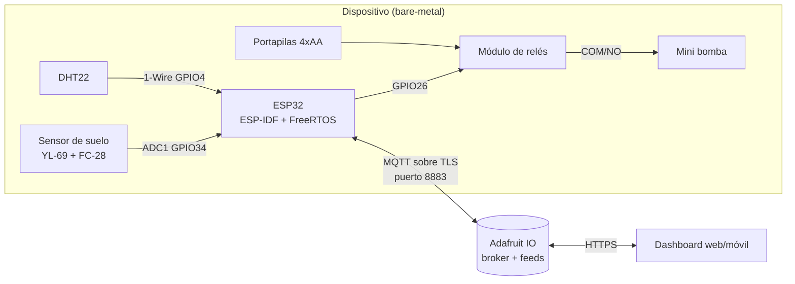
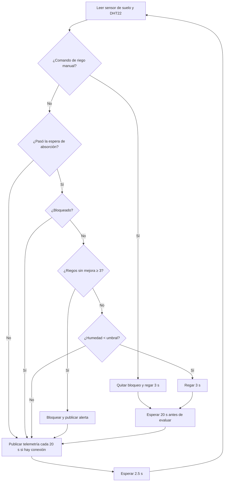

# Arquitectura

## Vista general

## Capas

| Capa | Componente | Responsabilidad |
|---|---|---|
| Percepción | Sensor de suelo, DHT22 | Medir humedad del suelo, temperatura y humedad del aire |
| Actuación | Relé + bomba | Regar la planta |
| Control (edge) | ESP32, `tarea_control` | Leer sensores, decidir riego, aplicar seguridad. **Funciona sin internet** |
| Comunicación | WiFi + MQTT/TLS (`esp-mqtt`) | Publicar telemetría, recibir comandos |
| Nube | Adafruit IO | Guardar histórico, dashboard, controles remotos |

## Protocolo: MQTT

Se eligió MQTT (y no HTTP) porque:
- Es **bidireccional**: el ESP32 recibe comandos del dashboard al instante, sin consultar periódicamente.
- Tiene **poca sobrecarga** por mensaje, ideal para un microcontrolador.
- Soporta **Last Will**: si el ESP32 se desconecta sin avisar, el broker publica `offline` en el feed `estado`.
- Adafruit IO lo soporta de forma nativa, con TLS en el puerto 8883.

### Tópicos

Formato: `<usuario>/feeds/<feed>`

| Feed | Dirección | Tipo | Descripción |
|---|---|---|---|
| `humedad-suelo` | ESP32 → nube | int (%) | Cada 20 s |
| `temperatura` | ESP32 → nube | float (°C) | Cada 20 s |
| `humedad-aire` | ESP32 → nube | float (%) | Cada 20 s |
| `bomba` | ESP32 → nube | 1 / 0 | Al encender/apagar |
| `alertas` | ESP32 → nube | texto | Fallas del DHT22, bloqueo de seguridad |
| `estado` | ESP32 → nube | online / offline | Al conectar (y Last Will) |
| `riego-manual` | nube → ESP32 | 1 | Botón del dashboard |
| `umbral` | nube → ESP32 | int (5–95) | Slider del dashboard |

También se suscribe a `<usuario>/throttle` y `<usuario>/errors` para detectar el límite de datos y errores de Adafruit IO.

**Presupuesto de datos:** el plan gratuito permite 30 datos/min. El sistema publica 3 datos cada 20 s (9/min) más eventos de la bomba, muy por debajo del límite.

## Flujo de control

## Manejo de errores

| Falla | Qué hace el sistema |
|---|---|
| Sin WiFi al arrancar o se cae | Sigue regando de forma local; reconexión automática |
| Broker MQTT caído o credenciales mal | Reintento cada 5 s; mensaje claro en el log |
| Límite de datos de Adafruit IO | Pausa las publicaciones 60 s |
| DHT22 no responde o dato corrupto (checksum) | Conserva el último valor válido; tras 5 fallos publica alerta |
| Depósito vacío / sensor fuera de la tierra | Tras 3 riegos sin que suba la humedad, bloquea el riego y alerta |
| Umbral inválido desde el dashboard | Se ignora (rango 5–95 %) |
| Reinicio del ESP32 | El relé arranca apagado; recupera el último umbral con `/get` |
